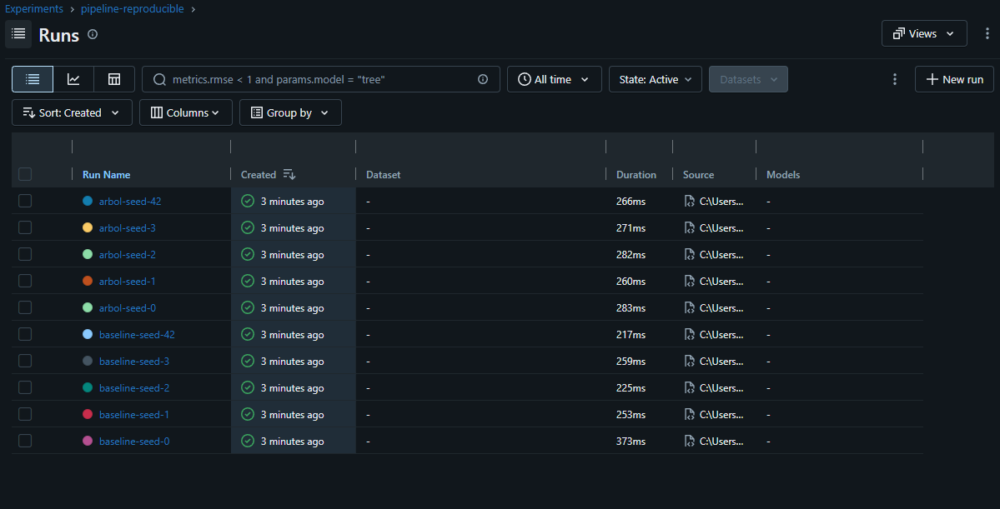

# Pipeline de ML reproducible · ActivaFit – Sistema predictivo para la retención inteligente de socios en centros deportivos

Machine Learning I · Proyecto Integrador · Entregable individual
Alumno(a): Sebastian Ramirez Coronado · Grupo: 1 · Algoritmo asignado: Árbol de decisión

**Resumen:** Clasifica si un socio de ActivaFit abandona su membresía (`Dropout`) usando `DadosV3.csv` (Sport Services Dataset, fuente: Kaggle Open Datasets), con 14 942 registros. El algoritmo individual es un Árbol de Decisión.

## Cómo reproducir
Probado con **Python 3.14.4** en **Windows 11** (`Windows-11-10.0.26300-SP0`).

macOS / Linux:
```bash
git clone https://github.com/Sebasx18201/repro-ml-Ramirez.git repro && cd repro
python -m venv .venv && source .venv/bin/activate
pip install -r requirements.txt
PYTHONHASHSEED=0 python -m src.prepare_data
PYTHONHASHSEED=0 python -m src.train --seed 42
PYTHONHASHSEED=0 python -m src.run_seeds
```
Windows (PowerShell):
```powershell
git clone https://github.com/Sebasx18201/repro-ml-Ramirez.git repro; cd repro
python -m venv .venv; .venv\Scripts\Activate.ps1
pip install -r requirements.txt
$env:PYTHONHASHSEED=0
python -m src.prepare_data
python -m src.train --seed 42
python -m src.run_seeds
```

## Resultado esperado
Una corrida (`--seed 42`):
```json
{"seed": 42, "modelo": "arbol", "data_md5": "7f668c20ebe1f8c985985f86c7546db8", "accuracy_mean": 0.85058, "accuracy_sd": 0.00391, "f1_macro_mean": 0.70634, "f1_macro_sd": 0.00271, "recall_macro_mean": 0.67233, "recall_macro_sd": 0.00261}
```
Cinco semillas (`results/results_summary.csv`), con semillas 0, 1, 2, 3 y 42:

| Modelo | Accuracy (media ± DE entre cinco semillas) |
|---|---:|
| Baseline | 0.8010 ± 0.0000 |
| Árbol de decisión | 0.8511 ± 0.0018 |

**Resultado reportado:** Accuracy = media ± DE entre cinco semillas (baseline: 0.8010 ± 0.0000; Árbol de Decisión: 0.8511 ± 0.0018).



## Estructura de datos (data lake)
| Zona | Carpeta | Contenido | Regla |
|---|---|---|---|
| raw (bronze) | `data/raw/` | `DadosV3.csv`, archivo original | Nunca se edita manualmente |
| processed (silver) | `data/processed/` | Datos procesados; MD5 `7f668c20ebe1f8c985985f86c7546db8` | Se regenera con `src.prepare_data` |
| results (gold) | `results/` | Métricas | Se regenera con `src.run_seeds` |

Ver `data/MANIFIESTO.md`.

## Qué lo hace reproducible
| Requisito | Cómo se cumple |
|---|---|
| ≥ 6 commits | El historial del repositorio cumple el mínimo requerido. |
| Sin fuga de datos | `src/train.py` incluye el preprocesamiento dentro del Pipeline, que se ajusta durante la validación cruzada. |
| Aleatoriedad fija | Los comandos fijan `PYTHONHASHSEED=0`; la partición usa `random_state=42`. |
| 5 semillas en MLflow, media ± DE | `src/run_seeds.py` registra el baseline y el modelo para las semillas 0, 1, 2, 3 y 42. |
| Mismos datos para todos | El MD5 processed `7f668c20ebe1f8c985985f86c7546db8` permite verificar que los repositorios comparados usen los mismos datos. |
| Entorno exacto | `requirements.txt` fija numpy==2.5.4, pandas==3.1.0, scikit-learn==1.9.1 y mlflow==3.17.2. |
| Prueba reservada | El 20 % de prueba no se usa en este entregable; la validación cruzada se hace sobre el 80 % de entrenamiento. |

## Prueba del extraño
**PENDIENTE.** Aún no se ha realizado. Completar con el nombre y grupo del compañero, el enlace al Issue y el resultado.

## Limitaciones
- El dataset está desbalanceado; los resultados corresponden a este conjunto y no garantizan el mismo rendimiento en otros gimnasios o poblaciones.
- El Árbol de Decisión está configurado con profundidad máxima 5.
- El conjunto de prueba permanece reservado para evaluación posterior; no se usó para ajustar hiperparámetros.

## Respuestas
1. El imputador y el escalador están dentro del Pipeline para evitar fuga de datos. Así, en cada validación cruzada, estos pasos aprenden solo con los datos de entrenamiento y no con los datos que se usan para validar el modelo.
2. El 20 % de prueba no se usa porque debe reservarse para evaluar el modelo al final. Si se utilizara antes para elegir el modelo, el resultado podría verse mejor de lo que realmente es, lo cual influiría en una elección incorrecta.
3. La desviación estándar mide cuánto varían los resultados entre las cinco semillas. Sin embargo, no garantiza que el modelo tenga el mismo rendimiento con datos diferentes.
4. Mi árbol supera al baseline en las cinco semillas. Además, la diferencia entre ambos es mayor que la desviación estándar, por lo que el árbol presenta una mejora consistente y un resultado positivo para este experimento.
5. El archivo de la zona raw no se modifica porque debe conservarse exactamente como se obtuvo originalmente. Si se cambia, los resultados pueden variar y el proyecto deja de ser reproducible. El MD5 sirve como una huella digital para comprobar que otra persona está usando exactamente el mismo archivo.
6. PYTHONHASHSEED=0 debe colocarse antes de iniciar Python porque esa configuración se define al momento en que Python arranca. Si se intenta cambiar dentro del programa, ya sería demasiado tarde y no garantizaría la misma reproducibilidad.

## Declaración de uso de IA
Se utilizaron ChatGPT y Codex para interpretar instrucciones, revisar la configuración, adaptar la lectura del CSV con separador `;`, apoyar la documentación y revisar comandos y reproducibilidad. Yo me ecnargué de la ejecución y verificación de los resultados obtenidos, además de revisar el código.

## ENTORNO DE EJECUCIÓN
Sistema operativo: Windows 11 (Windows-11-10.0.26300-SP0)

Python: 3.14.4

NumPy: 2.5.4

pandas: 3.1.0

scikit-learn: 1.9.1

MLflow: 3.17.2
